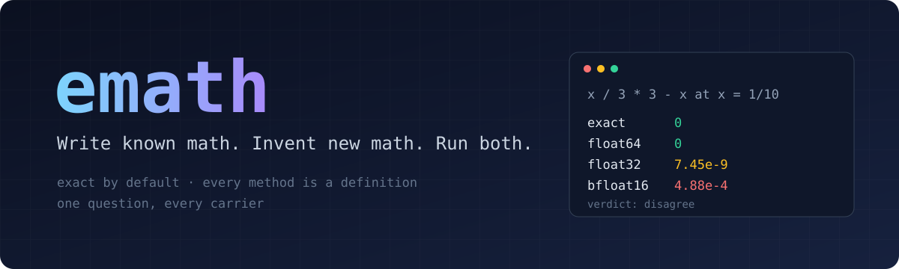
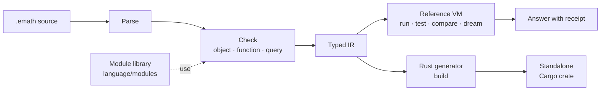

<div align="center">



[](#status-and-roadmap)
[](rust-toolchain.toml)
[](LICENSE)
[](#built-with-factory)

[Quick start](language/QUICKSTART.md) ·
[What computes](language/CAPABILITY.md) ·
[Reference](language/reference/README.md) ·
[Discovery](language/DISCOVERY.md) ·
[Manual](MANUAL.md)

</div>

<br>

emath is a programming language for mathematics that computes. You write
definitions the way you would on a whiteboard, and emath gives back an
exact answer, a trajectory, a standalone Rust crate, or a clear reason
it cannot compute yet. The compiler is written in Rust. The mathematics
is written in emath, where you can read it.

## Why emath

Mathematical work is usually split across tools: the idea in a notebook
or a computer algebra system, the proof in a proof assistant, and the
program that runs it in a hand-written solver. emath puts the definition
and the running program in one place.

- **Exact by default.** Integers are unbounded and rationals are exact,
  so `1/10 + 2/10 == 3/10` is true. Floating point is something you
  choose, not something that happens to you.
- **Every method is a definition you can read.** Sums, derivatives,
  linear solvers, Runge-Kutta steppers, and eigenvalue routines are
  ordinary `.emath` modules. Import them, read them, or replace them.
- **One question, every number system.** `emath compare` runs a function
  in exact rationals, 64, 32, and 16-bit floats, 64-bit integers,
  intervals, and affine forms, and shows exactly where the answers part.
- **Programs are values.** `quote` turns code into data a program can
  inspect, build, and run, so a discovery loop can invent definitions
  and keep the good ones in a library you own.
- **Honest answers.** When emath cannot answer, it says why
  (`singular_matrix`, `budget_exhausted`) instead of returning a
  plausible wrong value.

## A taste

```emath
use fold.reduce

emath function SumOfSquares:
    inputs:
        n: Int
    outputs:
        total: Int
    definitions:
        total = sum(map(function k in Int: k * k, range(1, n)))
    tests:
        example <first_ten>:
            given n = 10
            expect total == 385
```

```console
$ emath test sum_of_squares.emath
ok first_ten
1 authored tests passed

$ emath run sum_of_squares.emath --function SumOfSquares --set n=100
338350

$ emath build sum_of_squares.emath --out squares/    # a standalone Rust crate
```

The same question in every number system. `x / 3 * 3 - x` is exactly
zero, but not every format agrees:

```console
$ emath compare third.emath --function Third --set x=1/10
reference  0/1
exact      0/1
float64    0
float32    0.000000007450580596923828   (gap 7.450580596923828e-9)
bfloat16   0.00048828125   (gap 4.8828125e-4)
int64      0/1
interval   [-0.000000000000000027755575615628914, 0.000000000000000027755575615628914]   (width 5.551115123125783e-17)
affine     0/1
verdict: disagree
```

## Getting started

emath builds from source with the nightly toolchain pinned in
[`rust-toolchain.toml`](rust-toolchain.toml), which `rustup` selects
automatically.

```console
$ git clone https://github.com/AdityaVG13/emath.git
$ cd emath
$ cargo build -p emath-cli
$ ./target/debug/emath check language/examples/intro/add-exact.emath
```

The first build takes a few minutes. Add `target/debug` to your `PATH`
to call `emath` directly. Inside the repository it finds the language
library on its own; elsewhere, set `EMATH_ROOT` to the repository root.

From there, `emath new NAME` starts a project and the
[quick start](language/QUICKSTART.md) walks you through your first
program.

## Commands

| Command | What it does |
| --- | --- |
| `emath check FILE` | Check a file without running it |
| `emath run FILE --function F` | Evaluate a function and print the result |
| `emath test FILE` | Run the file's built-in examples |
| `emath build FILE` | Turn the file into a standalone Rust crate |
| `emath compare FILE --function F` | Run in every number system and report the gaps |
| `emath dream FILE` | Start a background discovery run with a live dashboard |
| `emath keep FILE --function F --to LIB` | Save a discovered program into your library |
| `emath api --search TEXT` | Find what you can call and where it lives |

`emath help` lists every command. The [manual](MANUAL.md) covers flags,
saved runs, exit codes, and JSON output.

## How it works



The Rust core is deliberately small: a parser, a type checker, an
intermediate representation, a reference interpreter, and a code
generator. It knows no mathematics. Every method lives in the
[module library](language/modules/README.md) or in
[worked domains](language/domains/README.md) such as a pendulum or
SHA-256. When the language cannot express something, the core gains a
general capability, never a special case for one subject.

## Built with Factory

emath is built with [Factory](https://factory.ai), whose Droids are AI
software engineering agents. Aditya sets the direction and reviews the
results. Droids do the engineering in this repository: they design
language features, write the Rust compiler, author the module library
and its tests, and keep this documentation current. For larger pushes,
several Droids work in parallel on the same branch, each reserving the
files it is editing.

A compiler for mathematics is demanding work to hand to an agent, since
a wrong sign or a rounding slip can pass a casual read. emath is
designed so that every change has to prove itself:

- **Answers are exact and repeatable.** Exact arithmetic and a
  deterministic interpreter give the same answer and the same work count
  on every run, so a regression shows up as a changed number.
- **The mathematics carries its own tests.** Modules include worked
  examples with expected results, more than 4,000 across the library,
  and `emath test` runs them.
- **Two engines must agree.** Conformance tests run modules both in the
  reference interpreter and as generated Rust, and require identical
  results.
- **The tests are tested.** A new test must fail before the change that
  makes it pass, and is then checked by deliberately breaking the code
  it covers. A test that misses the break gets rewritten.

Work is judged by evidence anyone can rerun, not by how convincing it
sounds.

## Status and roadmap

emath is in active development and is not yet published to crates.io.
Work proceeds in a fixed order:

- [ ] **Language and mathematical engine** (in progress): the language,
  the interpreter, Rust generation, and a module library spanning
  algebra, analysis, numerics, probability, optimization, and discovery.
- [ ] **Browser workbench** (next): the full language running in the
  browser through WebAssembly. An early version runs today with
  `cargo xtask build-web` and `cargo xtask serve-web`
  ([details](web/README.md)).
- [ ] **Ecosystem** (later): an editor language server, incremental
  builds, bridges to external solvers and proof checkers, and a package
  registry.

**What emath does not claim.** Compiling is not proving. emath
guarantees that the program is what you wrote, not that the mathematics
is true, and a check over finitely many cases is only that. A separate
proof-checking step is planned; see [Why not just Lean?](WHY_NOT_LEAN.md)

## Documentation

| | |
| --- | --- |
| [Language guide](language/README.md) | What emath is and where everything lives |
| [Quick start](language/QUICKSTART.md) | Your first program in a few minutes |
| [What computes](language/CAPABILITY.md) | What works today and what is refused |
| [Reference](language/reference/README.md) | The full language specification |
| [Discovery](language/DISCOVERY.md) | Discovery loops and research modules |
| [Manual](MANUAL.md) | The command-line tool in detail |
| [Architecture](implementation/CONSTITUTION.md) | Design principles and crate layout |

## Contributing

Contributions are welcome. Please reach out to
[Aditya](https://x.com/adityavg13) before you start so we can agree on
the direction, then see [CONTRIBUTING.md](CONTRIBUTING.md). Security
issues: [SECURITY.md](SECURITY.md).

## License

Apache-2.0. See [`LICENSE`](LICENSE).
